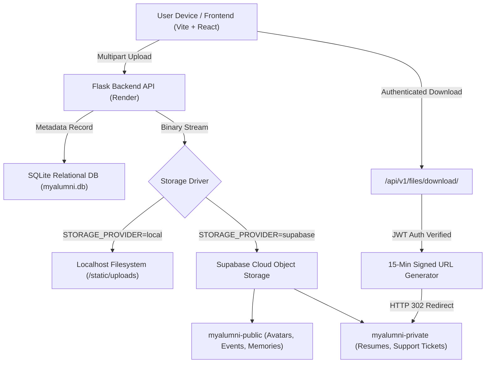

# Supabase Cloud Storage Setup Guide for MyAlumni 2.0

This guide provides step-by-step instructions for configuring **Supabase Cloud Object Storage** as the production file storage driver for MyAlumni 2.0's Universal File Upload System.

---

## 1. Architectural Overview



### Key Principles
1. **Relational Database Preserved:** The core application database remains **SQLite** (`myalumni.db`). Supabase is used strictly as an S3-compatible cloud object store for binary files. No database migration to Supabase PostgreSQL is required.
2. **Dual-Driver Architecture:**
   - **Localhost Development (`STORAGE_PROVIDER=local`):** 100% offline, zero cloud setup, saves directly to `backend/static/uploads/`.
   - **Production Deployment (`STORAGE_PROVIDER=supabase`):** Uploads stream to Supabase Storage, guaranteeing that uploaded resumes, certificates, and media survive Render server restarts and redeployments.
3. **Zero Secrets in Frontend:** Supabase credentials (`SUPABASE_URL` and `SUPABASE_SERVICE_KEY`) reside exclusively in backend environment variables. The client never talks directly to Supabase with privileged keys.
4. **Access Control & Privacy:**
   - **Private Documents** (Student/Alumni resumes, application attachments, support tickets): Stored in `myalumni-private`. Direct public access is blocked. Files can only be downloaded through the authenticated backend gateway (`GET /api/v1/files/download/<file_id>`) which validates JWT credentials and role permissions before redirecting to a 15-minute temporary signed URL.
   - **Public Media** (Profile photos, event banners, batch memories, discussion photos, published academic resources): Stored in `myalumni-public`. Served directly via Supabase's high-speed global CDN.

---

## 2. Step-by-Step Supabase Dashboard Setup (5 Minutes)

### Step 1: Create a Supabase Project
1. Log in to your [Supabase Dashboard](https://supabase.com/dashboard).
2. Click **New Project**.
3. Enter a Project Name (e.g. `myalumni-storage`) and a strong database password.
4. Select the region closest to your users.
5. Click **Create new project** (Supabase will take ~1-2 minutes to initialize).

### Step 2: Create Storage Buckets
1. In the left navigation menu, click **Storage** (or the folder icon).
2. Click **New Bucket**.
3. Create the **Public Bucket**:
   - **Name:** `myalumni-public`
   - **Public bucket:** **Toggle ON** (checked)
   - Click **Save bucket**.
4. Click **New Bucket** again to create the **Private Bucket**:
   - **Name:** `myalumni-private`
   - **Public bucket:** **Toggle OFF** (unchecked / private)
   - Click **Save bucket**.

> [!IMPORTANT]
> Keep `myalumni-private` strictly private. Never enable public access on `myalumni-private`. Private files are securely gated by the backend service key.

### Step 3: Retrieve Project API Credentials
1. In the left navigation menu, click **Project Settings** (gear icon) -> **API**.
2. Under **Project URL**, copy your API URL:
   - Example: `https://abcdefghijklm.supabase.co`
3. Under **Project API keys**, find the **`service_role` (secret)** key:
   - Click **Reveal** and copy the secret key.
   
> [!WARNING]
> Use the **`service_role`** key (NOT the `anon` public key). The backend needs the service-role key to upload files directly and generate signed download links for private files. **Never share or expose the service_role key to clients.**

---

## 3. Environment Variables Configuration

### A. Local Development (Offline Mode)
In `backend/.env` (or leave default):
```env
STORAGE_PROVIDER=local
UPLOAD_MAX_SIZE_MB=50
```
Local files are stored in `backend/static/uploads/`.

### B. Production Deployment (Render / Cloud Host)
Add the following Environment Variables in your **Render Dashboard** (under **Environment** tab):

| Variable Name | Required | Example / Default Value | Purpose |
| :--- | :---: | :--- | :--- |
| `STORAGE_PROVIDER` | **Yes** | `supabase` | Enables the Supabase Cloud Storage driver |
| `SUPABASE_URL` | **Yes** | `https://abcdefghijklm.supabase.co` | Your Supabase Project API URL |
| `SUPABASE_SERVICE_KEY` | **Yes** | `eyJhbGciOi...` | Supabase `service_role` secret key |
| `SUPABASE_PUBLIC_BUCKET` | Optional | `myalumni-public` | Bucket for public media & avatars |
| `SUPABASE_PRIVATE_BUCKET` | Optional | `myalumni-private` | Bucket for resumes & support tickets |
| `UPLOAD_MAX_SIZE_MB` | Optional | `50` | Maximum upload size threshold |

---

## 4. Production Web Server (Render WSGI)

In production, run the Flask backend with **Gunicorn**:
- **Build Command:** `pip install -r requirements.txt`
- **Start Command:** `gunicorn -w 4 -b 0.0.0.0:$PORT run:app`

`gunicorn>=21.2.0` is included in `backend/requirements.txt`.

---

## 5. Security & Verification Checklist

- [x] **Relational DB:** SQLite untouched (`myalumni.db`).
- [x] **Demo Accounts:** Demo credentials, user profiles, and test accounts preserved.
- [x] **Public CDN Access:** Public files served through CDN with caching headers.
- [x] **Private Document Protection:** Resumes and support tickets return HTTP 401/403 to unauthenticated requests.
- [x] **Signed URLs:** Time-limited to 15 minutes (`expiresIn: 900`).
- [x] **Backward Compatibility:** Existing external URLs and legacy local uploads continue to resolve seamlessly.
- [x] **Clean Replacement & Deletion:** File replacements and deletions remove objects from Supabase without orphaned database rows.

